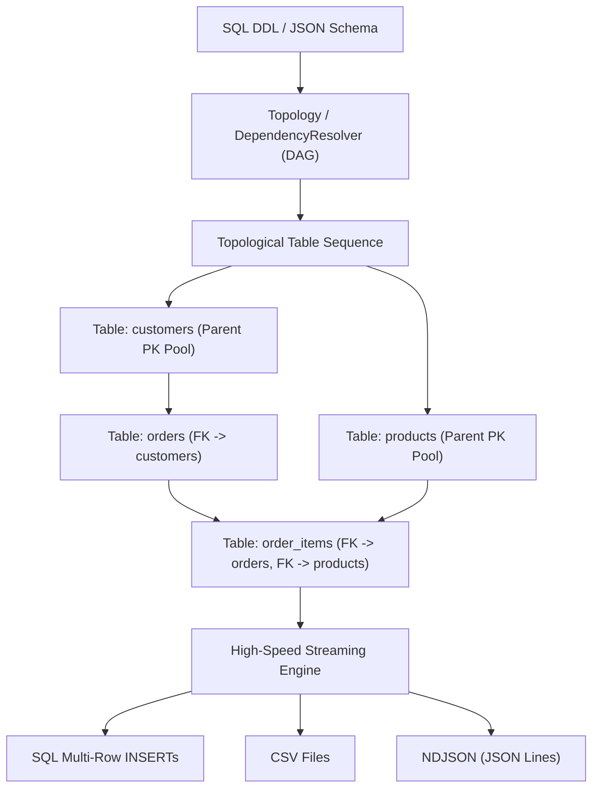

[🇸🇦 العربية](README.ar.md) | [🇬🇧 English](README.md)

# 🎲 eidcloud-fake-data

[](https://github.com/eidcloud/eidcloud-fake-data/releases)
[](https://php.net)
[](LICENSE)
[](https://colab.research.google.com/github/eidcloud/eidcloud-fake-data/blob/main/notebooks/quickstart.ipynb)

**eidcloud-fake-data** is a high-velocity, relational-aware synthetic data generator written in pure PHP 8.2+ with zero external vendor dependencies. It automatically analyzes database schemas (SQL DDL and JSON Schema) into Directed Acyclic Graphs (DAG), resolves topological table dependencies, and synthesizes 1,000,000+ realistic relational records with **100% strict Foreign Key referential integrity**.

---

## 📌 Architecture & Relational Topology

The engine resolves schema dependencies using Kahn's topological sort algorithm, ensuring parent tables are populated first. Primary keys are collected in an efficient reservoir buffer to resolve downstream foreign keys in O(1) time.



---

## 🚀 Key Capabilities

- **Zero External Dependencies**: Pure PHP 8.2+ native standard library.
- **Relational Integrity Guarantees**: Perfectly links parents and children (`customers -> orders -> order_items -> products`) across millions of rows without dangling foreign keys.
- **Native SQL DDL & JSON Ingestion**: Understands MySQL / PostgreSQL / SQLite DDL dialect (`CREATE TABLE`, `PRIMARY KEY`, `FOREIGN KEY`, inline constraints).
- **Localized Realistic Providers**:
  - **Arabic / MENA Regional**: Arabic names, Saudi mobile numbers (`+9665...`), Saudi IBANs, ZATCA 15-digit tax identification numbers (TIN), Saudi National IDs/Iqamas, Saudi cities and districts.
  - **International**: English names, email addresses, compliant RFC 4122 UUID v4, company names, cities, street addresses.
  - **Financial**: Accurate price amounts, multi-currency codes (SAR, AED, USD, EUR), payment methods (Mada, Apple Pay, Visa, STC Pay), transaction statuses.
- **High-Velocity Streaming I/O**: Constant, sub-10MB memory footprint via chunked multi-row SQL INSERT statements, CSV writers, and NDJSON streaming. Capable of generating over 10,000 relational rows per second.

---

## 💻 CLI Usage

The package comes with the `bin/eidcloud-fake` executable CLI tool:

### 1. Generate SQL Seed file from SQL DDL
```bash
php bin/eidcloud-fake ddl examples/ecommerce.sql --count=10000 --format=sql --out=seed.sql
```

### 2. Export to CSV Directory from DDL
```bash
php bin/eidcloud-fake ddl examples/ecommerce.sql --count=5000 --format=csv --dir=./data/
```

### 3. Generate from JSON Schema to NDJSON
```bash
php bin/eidcloud-fake generate examples/sample.json --count=20000 --format=ndjson --dir=./export/
```

### CLI Command Options
| Option | Description | Default |
|---|---|---|
| `--count=<N>` | Number of records to generate per table | Schema default or `100` |
| `--format=<fmt>` | Output format: `sql`, `csv`, `ndjson` | `sql` |
| `--out=<file>` | Target file path for SQL output | `stdout` |
| `--dir=<path>` | Target folder for CSV / NDJSON output | `./data` |
| `--locale=<loc>` | Provider locale: `mixed`, `ar`, `en` | `mixed` |
| `--batch-size=<N>`| Multi-row chunk size for SQL INSERTs | `500` |

---

## 📦 Programmatic Usage (PHP SDK)

```php
use EidCloud\FakeData\FakeDataGenerator;
use EidCloud\FakeData\Generators\SqlInsertStream;
use EidCloud\FakeData\Schema\DdlParser;

require_once __DIR__ . '/src/autoload.php';

// Parse schema
$ddl = file_get_contents('schema.sql');
$parser = new DdlParser();
$schema = $parser->parse($ddl);

// Initialize streaming generator
$stream = new SqlInsertStream('output_seed.sql', batchSize: 1000);
$generator = new FakeDataGenerator(locale: 'mixed');

// Generate 50,000 relational rows maintaining FK integrity
$generator->generate($schema, $stream, globalCount: 50000);
```

---

## 🧪 Testing

Run the zero-dependency automated test runner:

```bash
php tests/run_tests.php
```

All 27 assertions verify provider integrity, DAG ordering, circular dependency prevention, and 100% foreign key referential integrity.

---

## 👨‍💻 Author & Maintainer

**Eng. MHD. Shadi AL-Hasan**  
Lead Architect & Developer  
Email: [shadi@eidcloud.com](mailto:shadi@eidcloud.com)  
Website: [https://eidcloud.com](https://eidcloud.com)

---

## 📄 License

This software is released under the [MIT License](LICENSE).  
Copyright (c) 2026 MHD. Shadi AL-Hasan.

---

## 👤 Author & Maintainer

**Eng. MHD. Shadi AL-Hasan**  
- **Role:** Executive CTO & Enterprise Solutions Architect  
- **Email:** [mhd.shadi.alhasan@gmail.com](mailto:mhd.shadi.alhasan@gmail.com)  
- **Phone / WhatsApp:** [+963934005922](tel:+963934005922)  
- **Location:** Damascus, Syria  
- **GitHub:** [shadialhasan](https://github.com/shadialhasan)  

---

## 📄 License

This project is licensed under the MIT License - see the [LICENSE](LICENSE) file for details.  
Copyright (c) 2026 **MHD. Shadi AL-Hasan**. All rights reserved.
